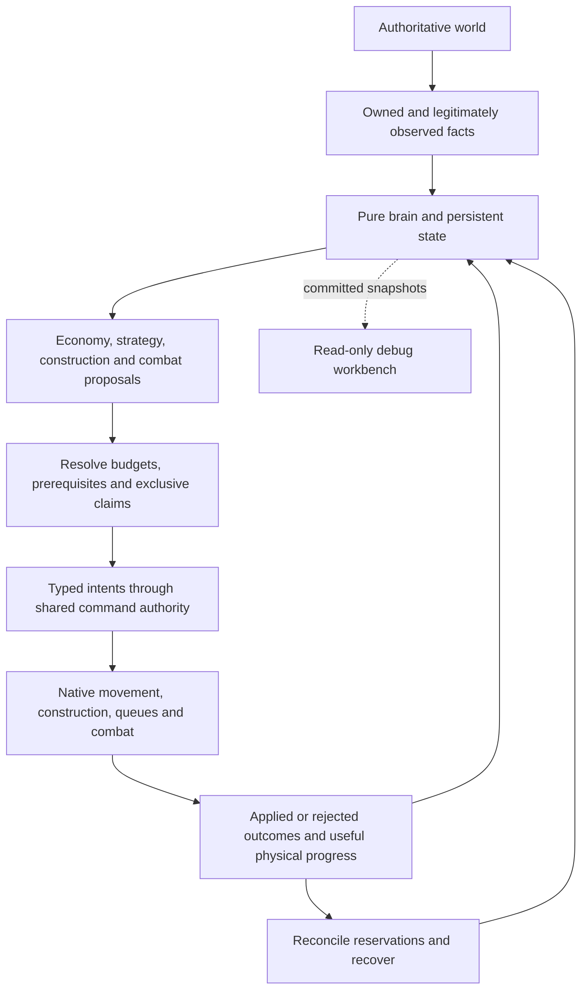

# Probable Waffle skirmish AI

The opponent uses a deterministic planner connecting economic needs, information, military opportunities and
recovery. It runs in the game without an LLM or external AI service. Tivara and Skaduwee use their actual faction
capabilities and prices. The former player strategy tree is retired; pawn behavior trees still execute native orders.

## Gameplay capabilities

| Responsibility          | What the controller does                                                                                                                                                |
| ----------------------- | ----------------------------------------------------------------------------------------------------------------------------------------------------------------------- |
| Opening and workforce   | Starts from legal faction resources, establishes essential workers/services, and restores the workforce after losses.                                                   |
| Economy and food        | Assigns useful gathering/tending work, considers delivered income and service capacity, and builds renewable food.                                                      |
| Supply and production   | Anticipates housing and useful military capacity, accounts for queues/unfinished buildings, and adds duplicate assets when demand justifies them.                       |
| Scouting                | Investigates starts, composition, access and stale contacts. Old information loses confidence; unseen current positions, health and queues stay private.                |
| Attacks and defense     | Assembles compatible squads, protects threatened economic sites, reinforces useful attacks, regroups and withdraws from unfavorable engagements.                        |
| Harassment              | Weighs exposed workers, resources, expansions and production against travel/counterforce; small raids receive bounded responses without abandoning main-front pressure. |
| Air and counters        | Uses observed opportunities/threats and actual movement/weapon domains to justify available air units and compatible responses.                                         |
| Research                | Weighs useful upgrades and counter research against force size, demand and competing spending.                                                                          |
| Placement and expansion | Chooses useful reachable sites, preserves production/worker/rally/retreat routes, and postpones optional expansion under credible visible home pressure.                |
| Fortifications          | Plans bounded walls, stairs and defensive posts with useful protection and friendly access. Preserves an opening where no functioning gate exists.                      |
| Access and transport    | Separates ground/water/air routes and tracks assembly, boarding, landing, unloading and useful reassignment where real content supports the mission.                    |
| Recovery                | Tracks physical progress and cumulative failure age, retains healthy long work, releases stale claims, and retries, retargets or abandons infeasible optional work.     |

These are implemented responsibilities. The coverage record below distinguishes native results from registered
scenarios and deferred acceptance; it does not claim every capability has complete runtime certification.

## How decisions become gameplay



The pure brain cannot query Phaser or mutate actors. It receives immutable permitted observations and proposes
ordered work. Shared command application enforces ownership, payment, prerequisites, queues, placement, paths and
targets. Stable identities reconcile delayed, rejected and duplicate outcomes without duplicate payments/effects.

Persistent state holds goals, knowledge, squads, demand, bases, reservations, transport and recovery. Deadlines use
simulation ticks. Deterministic ordering and bounded work reproduce decisions from equal input/state/seed. Debugging
reads committed history and never supplies hidden information or chooses gameplay.

## Tests and regression

| Layer                        | What it establishes                                                                                                                                       |
| ---------------------------- | --------------------------------------------------------------------------------------------------------------------------------------------------------- |
| Pure decision/contract tests | Sensible choices under controlled facts, deterministic arbitration, budgets, claim ownership, migration and negative controls.                            |
| Phaser integration tests     | Actual adapter, resource, queue, construction, command and lifecycle contracts, including registered preset validation.                                   |
| Native Playwright scenarios  | Ordinary lobby/game startup, real definitions/components, native commands, and independently measured payment, delivery, movement, combat and completion. |
| Catalog and tooling          | Manifest-derived selection, paired controls, source/fixture provenance, bounded reports and rejection of missing or zero-work evidence.                   |
| Periodic regression          | A bounded core land pack or the complete SCOUT-02 family, selected from the same scenario authority.                                                      |

The catalog contains 121 named obligations before variants. Registration, an explanation label or an accepted
command does not prove a useful physical result. Retained evidence includes both-faction victory, placement/recovery,
walls/expansion, scouting fairness, justified air, harassment, upgrades and selected ownership controls. Full-family
adaptation and extended save/load limitations remain explicit in the coverage record.

```sh
pnpm ai:regression -- --list
pnpm ai:regression
pnpm ai:regression -- --profile scout
pnpm ai:skirmish-matrix -- --scenario SCOUT-02 --mode runtime
pnpm ai:skirmish:report -- --failures-only --details
```

Ordinary `pnpm e2e` has an extended AI hook enabled by the exact value `RUN_AI_REGRESSION=true`. Automatic AI CI
jobs are currently commented out; local commands and manual dispatch remain. Native invocations are bounded to
30 minutes. Difficulty calibration is cancelled for this iteration.

## Source layout

| Area                                          | Entry point                                                                        |
| --------------------------------------------- | ---------------------------------------------------------------------------------- |
| Pure brain, planners and contracts            | [Gameplay AI](../libs/games/probable-waffle/gameplay/src/lib/player/ai-controller) |
| Phaser adapter and game-side test support     | [Runtime AI](../libs/games/probable-waffle/phaser/src/lib/player/ai-controller)    |
| Browser scenarios and outcome readers         | [Skirmish E2E](../apps/portal-e2e/src/e2e/probable-waffle/skirmish/ai)             |
| TypeScript tools, manifests and JSON fixtures | [Game-specific tooling](../tools/probable-waffle/skirmish/ai/README.md)            |

## Detailed contracts

- [Documentation index](../libs/games/probable-waffle/gameplay/src/lib/player/ai-controller/docs/README.md)
- [Decision cycle and authority](../libs/games/probable-waffle/gameplay/src/lib/player/ai-controller/docs/architecture/decision-cycle.md)
- [Contracts and tuning](../libs/games/probable-waffle/gameplay/src/lib/player/ai-controller/docs/architecture/contracts-and-tuning.md)
- [Command/effect ownership](../libs/games/probable-waffle/gameplay/src/lib/player/ai-controller/docs/architecture/command-effect-ownership.md)
- [Economy and production](../libs/games/probable-waffle/gameplay/src/lib/player/ai-controller/docs/architecture/economy-and-production.md)
- [Combat and strategy](../libs/games/probable-waffle/gameplay/src/lib/player/ai-controller/docs/architecture/combat-and-strategy.md)
- [World access and defense](../libs/games/probable-waffle/gameplay/src/lib/player/ai-controller/docs/architecture/world-access-and-defense.md)
- [Resilience and lifecycle](../libs/games/probable-waffle/gameplay/src/lib/player/ai-controller/docs/architecture/resilience-and-lifecycle.md)
- [Testing commands](../libs/games/probable-waffle/gameplay/src/lib/player/ai-controller/docs/testing/README.md)
- [Generated scenario catalog](../libs/games/probable-waffle/gameplay/src/lib/player/ai-controller/docs/testing/scenario-catalog.md)
- [Native E2E contract](../libs/games/probable-waffle/gameplay/src/lib/player/ai-controller/docs/testing/runtime-e2e.md)
- [Debugging workbench](../libs/games/probable-waffle/gameplay/src/lib/player/ai-controller/docs/debugging/README.md)
- [Incident reproduction](../libs/games/probable-waffle/gameplay/src/lib/player/ai-controller/docs/debugging/incident-reproduction.md)
- [Evidence and follow-ups](../libs/games/probable-waffle/gameplay/src/lib/player/ai-controller/docs/testing/coverage-status.md)

## Remaining boundaries

Real-peer reconnect, host transfer and stale-command certification belong to the independent
[#819 multiplayer follow-up](https://github.com/JernejHabjan/fuzzy-waddle/issues/819). Extended active save/load
continuation belongs to [#823](https://github.com/JernejHabjan/fuzzy-waddle/issues/823). Broader matrix execution and
optional island content retain their own issues. Existing passes do not establish overall playing strength or
complete multiplayer reliability. Durable docs and issues own future work; completed session handoffs are retired.
